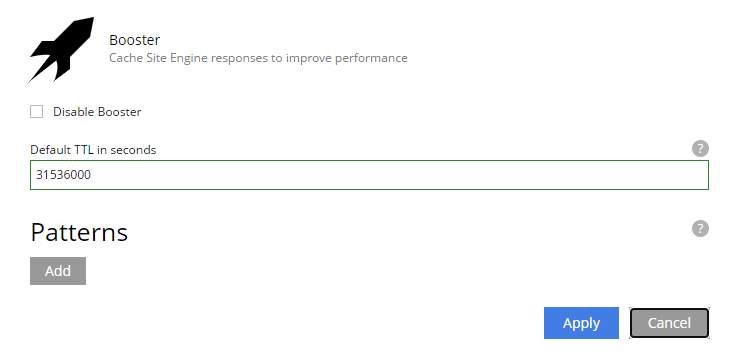

= Configuration

== Global configuration

Configure Booster by adding a configuration file to your XP instance.

`XP_HOME/config/com.enonic.app.booster.cfg`

.Example configuration with default values
[source,properties]
----
cacheTtl = 3600
cacheSize = 10000
appsForceInvalidateOnInstall =
excludeQueryParams =
disableCacheStatusHeader = false
cacheMimeTypes = text/html, text/xhtml
overrideHeaders =
----

cacheTtl:: Default time-to-live (TTL) for the cache is seconds. The default value is 3600 seconds (1 hour).
cacheSize:: Total number of items in the cache. The default value is 10000.
appsForceInvalidateOnInstall:: Comma-separated list of applications that should invalidate the cache on their installation. By default, no applications are listed.
excludeQueryParams:: Comma-separated list of query parameters that should be excluded from the cache key. Allows to add extra query parameters to exclude from the cache key without need to change default. A token prefixed with `-` removes the given parameter from the preset (e.g. `-cid` drops `cid` from the effective list). By default, no extra query parameters are listed.
excludeQueryParamsPreset:: This comma-separated list contains "preset" of query parameters that will not be affected by changing `excludeQueryParams`. More details about this below:
disableCacheStatusHeader:: If set to `true` `Cache-Status` header is not sent in the response. The default value is `false`.
cacheMimeTypes:: Comma-separated list of MIME types that should be cached. The default value is `text/html, text/xhtml`.
overrideHeaders:: Comma-separated list of instructions that override headers. By default, no instructions are listed. Use with causion.

=== Query Parameters

Booster considers query parameters when generating the cache key. However, some query parameters are not relevant, and should be excluded for a better performing cache. Examples of such are marketing and ads related parameters, where the rendered result will look the same regardlessly.

`excludeQueryParamsPreset` contains a list query parameters that should be excluded from the cache key. The default preset is sourced from https://github.com/mpchadwick/tracking-query-params-registry[mpchadwick/tracking-query-params-registry] plus 5 HubSpot parameters (`_hsenc`, `__hssc`, `__hstc`, `__hsfp`, `hsCtaTracking`) that are not part of that registry. The registry is not included as a dependency, but the preset is maintained by Enonic team and updated periodically.

If you want to keep the default list and add extra query parameters to exclude from the cache key, you can use the `excludeQueryParams` configuration property. Prefixing a parameter with `-` in `excludeQueryParams` removes it from the preset — for example, if your site uses `?cid=` legitimately:

[source,properties]
----
excludeQueryParams = -cid, my_custom_param
----

To override the presets entirely, simply add your own version of `excludeQueryParamsPreset` in the configuration file. The `-` prefix is only honored in `excludeQueryParams`, not in `excludeQueryParamsPreset`.

NOTE: If page rendering varies on any of the excluded parameters, make sure that Booster application does not cache the response, for instance by having `Cache-Control: private` header in the controller's response.

=== MIME Types

Booster caches `text/html` and `text/xhtml` MIME types by default. The `cacheMimeTypes` configuration property is a comma-separated list of MIME types that should be cached.

Allow caching of `text/plain` (such as robots.txt), `text/xml` (such as sitemap.xml) and application/manifest+json (manifest.json) MIME types:
[source,properties]
----
cacheMimeTypes=text/html, text/xhtml, text/plain, text/xml, application/manifest+json
----

NOTE: Booster does not cache responses with `Vary` header, including but not limited to `Vary: Accept`.

=== Control downstream cache

Different CDN and proxy servers can cache the response. Booster can help to control the downstream cache by using `overrideHeaders` configuration property allows to override response headers. The property is a comma-separated list of instructions that override headers. Each instruction is a key-value pair separated by a colon. The key is the header name and the value is the header value. The header value can contain placeholders that are replaced with the actual value from the original response.

Disable caching in the downstream cache (CDN and browser):
[source,properties]
----
overrideHeaders="Cache-Control: private, no-store"
----

Disable cache in Fastly CDN but leave browser caching instruction as is:
[source,properties]
----
overrideHeaders="Surrogate-Control: private"
----

Disable cache in Cloudflare CDN but leave browser caching instruction as is:
[source,properties]
----
overrideHeaders="Cloudflare-CDN-Cache-Control: private"
----

Allow Fastly CDN to cache the response for 24 hours, but browser should cache the response for 1 minute:
[source,properties]
----
overrideHeaders="Surrogate-Control: max-age=86400","Cache-Control: max-age=60"
----

== Site configuration

When adding Booster to a site, it may be tuned specifically

=== Default TTL

Default TTL setting allows to specify cache TTL for controller responses without max-age or s-max-age headers.
By default, the value is not set and the cache TTL is determined by the `cacheTtl` configuration property.

=== Advanced settings

==== Component TTL

Component TTL setting to specify cache TTL for _component_ controller responses without max-age or s-max-age headers. If not specified Default TTL is used.

==== URL Patterns

By default, Booster caches all regular paths within a site. `Cache Patterns` let you limit caching to some paths only, or exclude some paths from caching.

The rules are:

* If the list is empty, all paths are cached.
* If the list contains one or more patterns, a request is cached only when *at least one* pattern accepts its path. Paths that are not accepted by any pattern are not cached.
* A pattern without `Invert` accepts the paths that match the regular expression.
* A pattern with `Invert` accepts the paths that do *not* match the regular expression.

In other words, the list is a single "cache this" list where the patterns are combined with OR. There is no separate exclude list: an exclusion is written as one inverted pattern, or as a part of the regular expression itself. See the <<url_patterns_examples,examples>> below.

A pattern is a Java regular expression with the same syntax as https://developer.enonic.com/docs/xp/stable/framework/mappings#pattern_mappings[XP Framework pattern mappings]. Keep the following in mind when writing one:

* The pattern is matched against the content path relative to the site, starting with `/`. For a site at `/mysite`, the content `/mysite/blog/my-post` is matched as `/blog/my-post`, and the site itself is matched as `/`. Virtual host mappings do not affect the path.
* The pattern must match the *whole* path, not just a part of it. `/blog` matches only the `/blog` page itself. To match a page and everything below it, use `/blog(/.*)?`.
* Matching is case-sensitive.
* Query parameters are ignored, unless the pattern contains an escaped question mark (`\?`). In that case the pattern is matched against the path followed by `?` and the normalized query string (parameters sorted by name, excluded parameters removed), for example `/search?page=2&q=enonic`. The `?` is present even when the request has no query parameters.

[#url_patterns_examples]
===== Examples

.Cache everything, except one section
----
Pattern: /api(/.*)?
Invert:  checked
----

`/api` and everything below it is not cached. All other paths are cached.

.Cache everything, except several sections
----
Pattern: /(api|search|account)(/.*)?
Invert:  checked
----

List all exclusions in *one* inverted pattern, separated with `|`.

WARNING: Do not add a separate inverted pattern for each exclusion. Since it is enough that one pattern accepts the path, two inverted patterns `/api(/.*)?` and `/search(/.*)?` cancel each other out: `/api` is accepted by the second pattern, `/search` is accepted by the first one, and as a result everything is cached.

.Cache only selected sections
----
Pattern: /blog(/.*)?
Invert:  unchecked

Pattern: /docs(/.*)?
Invert:  unchecked
----

Only `/blog`, `/docs` and everything below them is cached. Nothing else is cached, including the site front page.

.Cache only the site front page
----
Pattern: /
Invert:  unchecked
----

.Cache one section, except a part of it
----
Pattern: /blog(/(?!drafts(/|$)).*)?
Invert:  unchecked
----

`/blog` and everything below it is cached, except `/blog/drafts` and everything below it. Nothing outside `/blog` is cached.

WARNING: Do not combine a regular pattern with an inverted one for this purpose. The patterns `/blog(/.*)?` and inverted `/blog/drafts(/.*)?` together cache the whole site: the inverted pattern accepts every path outside `/blog/drafts`, and `/blog/drafts` itself is accepted by the first pattern. Put the exclusion inside the regular expression using a negative lookahead `(?!...)`, as shown above.

.Cache everything, except requests with query parameters on one page
----
Pattern: /search\?.+
Invert:  checked
----

`/search?q=enonic` is not cached. `/search` without query parameters and all other paths are cached.

TIP: The patterns only decide if a response may be stored in the cache. All the other conditions described in <<how-it-works#,How it works>> still apply.

==== Bypass Headers and Cookies

Bypass Headers and Cookies let you define rules that prevent requests from being served from cache, and also ensure that matching responses are not stored in cache.

You can specify one or more header or cookie rules.
Each rule consists a `name` and Java Regular Expression `pattern`. An `invert` attribute can be  used to indicate that the result of evaluating the regular expression should be negated.

If any incoming request header or cookie matches a rule, the request will bypass the cache entirely.
